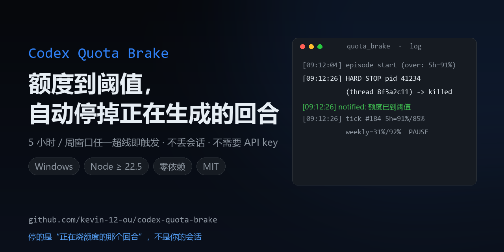
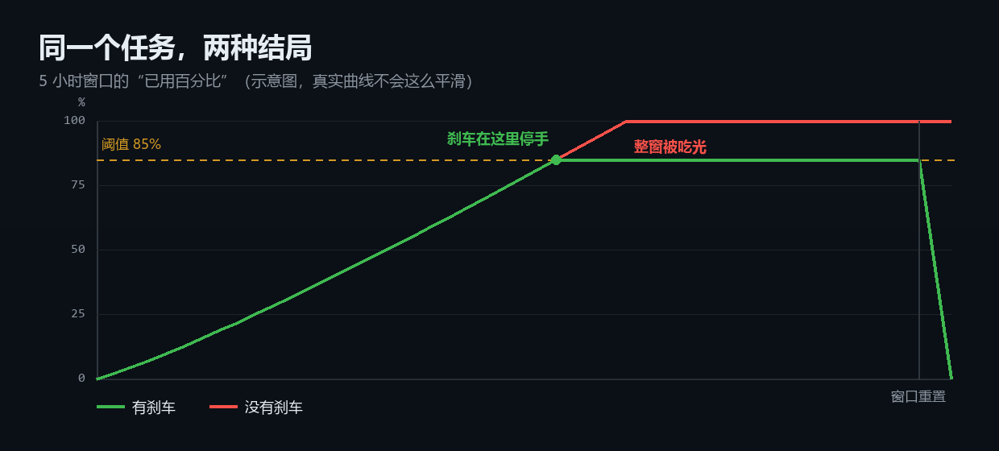
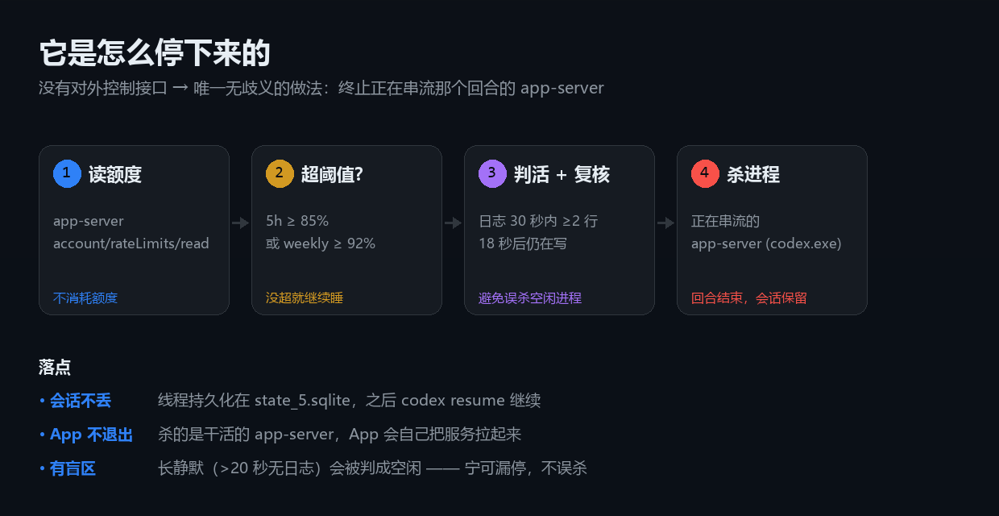
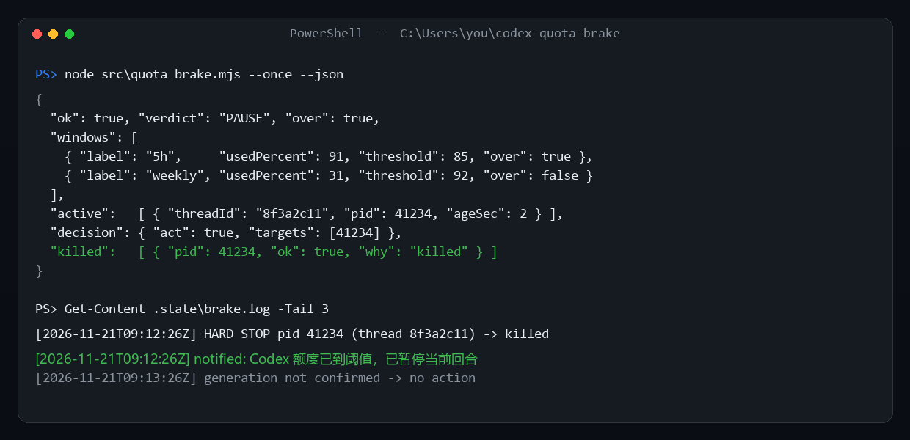
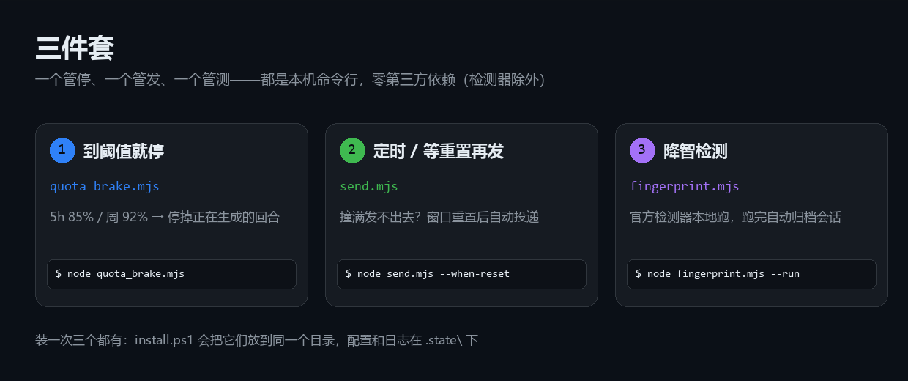

<div align="center">
  
</div>

<h1 align="center">Codex Quota Brake</h1>

<p align="center">
  <b>5 小时 / 周额度任一到达阈值 → 立刻停掉正在生成的那个回合。</b><br>
  不是退出 App，不是丢会话 —— 只是让"还在烧额度的那个回合"停下来。
</p>

<p align="center">
  <a href="https://github.com/kevin-12-ou/codex-quota-brake/releases/latest"></a>
  
  
  <a href="LICENSE"></a>
  
</p>

---

## 为什么会有这个工具

> **维护者的经验（不是官方机制）**
>
> 在我自己的账号上，额度撞满 5 小时 / 周上限之后，**反复**遇到过模型明显变笨、变慢、回答变敷衍的情况——
> 不是一两次，是几十次。官方文档没有解释这件事，本地日志里我也找不到对应事件（`model_rerouted` 记 0 次），
> 所以它只能算经验判断，我没法给你一个机制。
>
> 但这是我做这个工具的**第一动机**：尽量别撞满。
>
> 第二动机是可验证的：撞满之后到窗口重置前，你什么都干不了；而撞满通常发生在长任务跑到一半的时候。

所以默认值是 **80 预警 / 85 硬停**：先在 80% 提醒你收尾，真到 85% 才动手——而不是等 100% 撞墙。

## 你大概遇到过

- 撞满额度之后，模型像换了个更笨的（维护者本人的经验，见上一节）——所以你会想"别撞满"；
- 睡前让 Codex「继续把剩下的改完」，早上起来发现 **5 小时窗口被一个回合吃干**，接下来几小时什么都不能干；
- 想手动停，可面板一多就找不到那个停止按钮，点错了还会把草稿发出去；
- 想装个监控，结果它只会弹窗告诉你"已经用了 97%"，**并不会替你停**。

Codex 的额度是**账号级**的（手机、网页、另一台机器共用同一份），官方目前也没有
"到阈值自动暂停"的开关。这个工具补的就是这一段：**在你还能控制的时候停手**。

<div align="center">
  
</div>

## 60 秒上手

**要求**：Windows 10/11 + Node.js ≥ 22.5 + 已登录的 Codex（不需要任何 API key）。
"降智检测"额外需要 `npm i -g lmfpd`，其余两个工具零依赖。

```powershell
# 1. 下载并解压 ZIP，或：
git clone https://github.com/kevin-12-ou/codex-quota-brake.git
cd codex-quota-brake

# 2. 一键安装（检查 Node → 检查登录 → 装到 %LOCALAPPDATA% → 自启 → 自检）
powershell -NoProfile -ExecutionPolicy Bypass -File .\install.ps1

# 3. 看到这一行就说明通了（读额度不消耗额度）
#    {"ok":true,"verdict":"OK","windows":[{"label":"5h","usedPercent":27,...}]}
```

不想开机自启：`.\install.ps1 -NoAutostart`；先演练不落地：`.\install.ps1 -DryRun`。
不会用 PowerShell 就**双击 `install.cmd`**。

装完它就在后台按 10~60 秒的节奏看额度，到线就动手，并弹一个桌面通知。

## 它是怎么做到的

<div align="center">
  
</div>

一句话：**额度 ≥ 阈值 → 确认那个回合真的在跑 → 终止串流它的 app-server**。

- 读额度走本机 app-server 的 `account/rateLimits/read`，**不是模型请求，不消耗额度**；
- 判活看桌面版日志（30 秒内 ≥2 行）+ **18 秒二次确认**，避免误杀空闲进程；
- 只杀 `codex.exe`（白名单），按 pid 去重，30 秒冷却，10 分钟内最多 20 次；
- 线程还在 SQLite 里，`codex resume` 就能接着跑。

## 真实输出

<div align="center">
  
</div>

```jsonc
// 只看判定，不动手（安全）
{"ok":true,"verdict":"PAUSE","windows":[{"label":"5h","usedPercent":91,"threshold":85,"over":true}],
 "decision":{"act":true,"targets":[41234]}}
```

```text
# .state/brake.log
[2026-11-21T09:12:26Z] HARD STOP pid 41234 (thread 8f3a2c11) -> killed
[2026-11-21T09:12:26Z] notified: Codex 额度已到阈值，已暂停当前回合
```

## 不只是刹车：三件套

<div align="center">
  
</div>

安装脚本会把三个工具放到同一个目录（`%LOCALAPPDATA%\CodexQuotaBrake\`），共用一份额度读取库。

### 1. `quota_brake.mjs` —— 到阈值就停

就是上面讲的那个常驻刹车，默认开启（80% 软预警 / 85% 与 92% 硬停）。

### 2. `send.mjs` —— 定时 / 等额度重置后再投递

5 小时撞满之后 Codex 会拒绝新请求，可任务还得接着跑。它用 Codex 原生的
`codex queue --thread <id> --message <text>` 投递（不需要 GUI、中文原样送达）：

```powershell
node send.mjs --list                                        # 最近的会话（标题 + UUID，不用手抄）
node send.mjs --thread <id> --message "继续"                  # 立刻发
node send.mjs --thread <id> --message "继续" --in 2h30m       # 相对时间
node send.mjs --thread <id> --message "继续" --at "2026-11-21 09:00:00"
node send.mjs --thread <id> --message "继续" --when-reset     # 等 5h / 周窗口重置后自动发
node send.mjs --status        # 看还有多久
node send.mjs --cancel        # 取消并杀掉调度进程
```

`--when-reset` 会先读一次额度，挑**最先重置**的那个已超阈值窗口，到点 + 60 秒缓冲再投递
（`--threshold`、`--buffer` 可调）。调度进程是 detached 的，关掉终端也照样到点发。

> 投递失败不会静默：状态里会写清原因（比如会话已归档、UUID 写错、Codex 未登录）。

### 3. `fingerprint.mjs` —— 降智检测（可选）

用官方检测器（`lmfpd`：题目随机、评分全部在本地完成）给当前模型做指纹比对，回答由你本机的
`codex exec` 生成，跑完**自动归档**那几个测试会话：

```powershell
npm i -g lmfpd
node fingerprint.mjs --run --mode codex --count 3 --json
node fingerprint.mjs --status            # 最近一次结果
node fingerprint.mjs --log --days 30     # 历史
```

结果追加到 `.state/fp-results.jsonl`，可以自己画趋势或日历。`--mode relay` 还能对中转站做同样的检测
（需要 `baseurl` / `apikey`，建议放环境变量，别写进仓库）。

> 3 个样本才有可用的置信度（约 1~4 分钟，会消耗少量额度）；只跑 1 个样本只会得到"置信度不足"的弱结论。

## 配置

`%LOCALAPPDATA%\CodexQuotaBrake\config.json` —— **改完保存即生效，不用重启**。

| 键 | 默认 | 说明 |
|---|---|---|
| `threshold5h` | `85` | 5 小时窗口已用百分比阈值 |
| `thresholdWeekly` | `92` | 周窗口阈值（**任一**超过就触发） |
| `warnAt` | `80` | 软预警线：到这条线先弹一次提醒，给收尾的机会（`0` = 关闭） |
| `brakeEnabled` | `true` | 总开关；改成 `false` = 只看不动手，秒生效 |
| `brakeMaxKills` | `20` | 10 分钟窗口内最多停几次 |
| `brakeKillWindowSec` | `600` | 上面那个窗口长度 |
| `brakeKillCooldownSec` | `30` | 两次动手的最小间隔 |
| `pollSeconds` | `60` | 正常轮询间隔；接近/超阈值自动加速到 10~15 秒 |
| `codexBin` | `null` | 留空自动探测 `codex.exe` |

> 阈值别贴到 98/99：那时候基本是"撞墙才停"。`85/92` 的意思是"还能留点余量干别的活"；
> 80 的软预警则用来提醒你"再跑就要被硬停了"。

## 常见问题

**会不会丢我的会话？**
不会。杀的是 app-server 进程，线程本身持久化在 `~/.codex/state_5.sqlite`，之后 `codex resume`
或 `codex queue` 接着跑。当前回合里没落盘的中间动作会丢——这点没法避免。

**会不会杀错进程？**
只杀镜像名严格等于 `codex.exe` 的进程；其它一律拒绝并记日志。动手前还要过"18 秒二次确认"。

**会不会额外花额度？**
不会。额度查询是 app-server 的一次读操作，不是模型请求。实测连续 60+ 次读取，百分比不动。

**为什么不直接点界面上的"停止"按钮？**
试过：按钮靠截图/形状识别定位，App 一改版就找不到（日志会打 `NO-BUTTON`），还会在超阈值期间
每 10 秒重试一次空转。杀进程没有歧义。

**支持 macOS / Linux 吗？**
目前只做 Windows（`taskkill`、`HKCU` 自启、PowerShell 通知）。判活逻辑是跨平台的，但进程终止
和自启需要各写一份。

**撞满额度会不会"降权 / 降智"？**
这是本工具诞生的原因，写在最前面的「为什么会有这个工具」里：维护者在自己的账号上反复遇到过撞满后
变笨的情况（经验判断，官方没有给出机制说明）。本地日志里没有 `model_rerouted` 之类的事件可以对上，
所以它无法被证实、也无法被证伪——你只能按自己的经验决定要不要信。

无论你信不信这一条，"撞满 → 重置前没法干活"这件事都是确定的，提前停手都不亏。
如果你也遇到过类似现象，欢迎开 issue 贴你的观察（撞满前后同一个 prompt 的对比最有说服力）。

**会和别的额度工具冲突吗？**
不冲突，但**别同时开两个会动手的工具**——两个都在杀同一个进程的话，日志会很吵。

## 和别的方式比

| 方式 | 到阈值会不会真的停 | 要不要一直盯着 | 代价 |
|---|---|---|---|
| 手动看百分比、自己点停止 | 会，但你得在场 | 要 | 点错/点不到的日常 |
| 只读监控 / 菜单栏小组件 | **不会**，只是提醒 | 不用，但也没用 | 提醒完还是得自己动手 |
| **本工具** | **会**（杀 app-server） | 不用 | 当前回合的中间动作会丢 |
| 等官方出 `pause-at` | 未来会 | —— | 目前没有（社区一直在提） |

## 安全与隐私

- **不联网上传任何数据**，没有遥测；
- **不读取也不保存你的凭据**：额度查询走本机已登录的 Codex app-server；
- 日志只写本地 `.state\brake.log`：额度百分比、pid、线程 id 前 8 位；
- 代码就一个文件 `src/quota_brake.mjs`，零第三方依赖，可以直接读。

## 已知限制

- **只管本机的 `codex.exe`**：手机、网页版、另一台机器照扣（额度是账号级的）；
- 杀进程会结束**那个 app-server 上所有会话**的当前回合，不只是触发的那一个；
- 长静默（>20 秒不写日志）的回合会被判成空闲 —— 刻意保守：宁可漏停，不误杀；
- 阈值判定用后端返回的 `usedPercent`，重置倒计时只用于展示。

## 开发

```powershell
# 只看判定（默认不动作）
node src\quota_brake.mjs --once --json

# 造一个"假回合"验证链路，零额度（不联网、不调模型）
Copy-Item "C:\Program Files\nodejs\node.exe" .\faketurn\codex.exe -Force
Start-Process .\faketurn\codex.exe -ArgumentList '"burn.js"','exec' -WindowStyle Hidden
```

设计取舍、踩过的坑、实测记录都在 **[docs/DESIGN.md](docs/DESIGN.md)**。
实现：`src/quota_brake.mjs`（刹车）/ `src/send.mjs`（定时投递）/ `src/fingerprint.mjs`（降智检测）
/ `src/lib/quota.mjs`（共享的额度读取）。欢迎 PR：尤其是 macOS/Linux 的进程终止与自启实现。

## English

**Codex Quota Brake** stops the currently generating Codex turn the moment either your 5-hour or
weekly quota window crosses a configurable threshold — so one runaway task can't burn the whole window.

- Windows 10/11, Node ≥ 22.5, requires an already logged-in Codex (no API keys, no OAuth flow).
- Quota is read via the local app-server (`account/rateLimits/read`) — that call does not consume quota.
- To stop a turn it terminates the `codex.exe` app-server streaming that turn (whitelisted by image
  name, confirmed by an 18-second double sample). The thread is persisted — resume with `codex resume`.
- Install: `powershell -NoProfile -ExecutionPolicy Bypass -File .\install.ps1`
- Config: `%LOCALAPPDATA%\CodexQuotaBrake\config.json` (hot-reloaded).

## License

[MIT](LICENSE)
